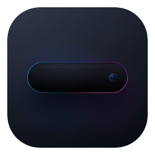
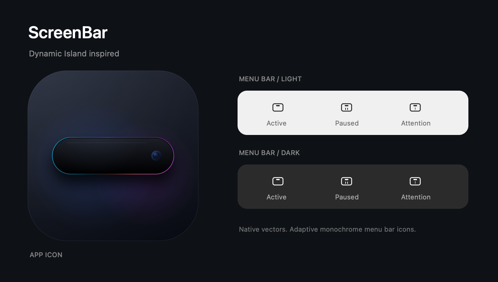

<p align="center">
  
</p>

<h1 align="center">ScreenBar</h1>

<p align="center">内蔵画面は常時表示。外部画面は自動非表示。</p>

ScreenBarは、MacBookの内蔵ディスプレイと外部ディスプレイでメニューバーの表示を使い分けるmacOSユーティリティです。外部画面ではメニューバーを自動で隠し、その分の領域をウィンドウに使えるようにします。

**現在は配布準備中です。公開版のアプリはまだ提供していません。** このリポジトリは今後のアプリ配布とサポート用です。アプリのソースコードは非公開で管理しています。



## 特徴

| 画面 | メニューバー |
| --- | --- |
| MacBookの内蔵ディスプレイ | 常時表示 |
| 外部ディスプレイ | 自動非表示。ポインタを上端に置くと表示 |

- メニューバーから一時停止・再開・終了を操作できます。
- 起動前の設定を保存し、終了時に復元します。強制終了時は別プロセスが復元を試みます。
- ネットワーク通信はなく、Accessibility・画面収録・Automationの許可は要求しません。

## インストール

Homebrew Tapを準備しています。以下は**公開後に予定しているコマンド**で、現在はまだ利用できません。

```sh
brew install --cask sonokr/tap/screenbar
```

公開版は、このリポジトリの[Releases](https://github.com/sonokr/screenbar-releases/releases)から提供する予定です。[Homebrew Tap](https://github.com/sonokr/homebrew-tap)には公開版に対応したCaskを配置します。

## 開発状況

現在の配布候補は0.1.2です。Apple Silicon / macOS 26.5.2 / 外部ディスプレイ1台で検証しています。公開前に、内蔵・外部画面の同時使用、メニュー操作、接続・切断、スリープ復帰、フルスクリーンなどの確認を進めています。Universal Binaryの生成には対応していますが、Intel実機での動作確認とは別です。

Developer ID署名・公証と、Homebrew経由のインストール・更新・削除の検証も公開前に行う予定です。

## 不具合の報告

[Issues](https://github.com/sonokr/screenbar-releases/issues)に、macOSのバージョン、画面構成、操作手順、期待した動作と実際の動作を記載してください。診断ログを共有する場合は、画面名や識別子など、公開したくない情報を除いてください。

非公開のmacOS APIを使用しているため、OS更新で動作が変わる可能性があります。
